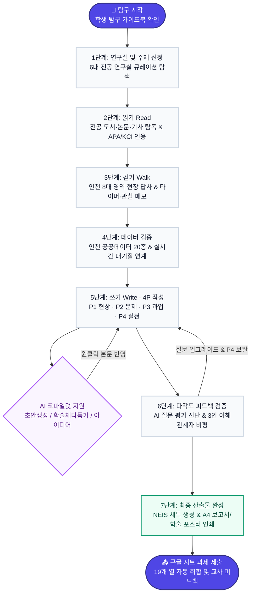

# 4P 읽·걷·쓰 전공연계 사회문제탐구 전체 흐름 순서도 (Flowchart)

> **인천광역시교육청 '읽·걷·쓰' 교육철학 기반 전공연계 사회문제탐구 웹 플랫폼 가이드북**  
> *현상(Phenomenon) · 문제(Problem) · 과업(Project) · 실천(Practice)*

---

## 🗺️ 전체 탐구 프로세스 순서도 (Mermaid Diagram)

---

## 📌 실증 탐구 예시 모델

* **선택 연구실**: `인문·사회 / 공론장 연구실 (Humanities & Social Sciences Lab)`
* **연구 주제**: **인천 원도심(신포·개항장) 무인 키오스크 확산에 따른 고령층 디지털 소외 현상과 세대 상생형 '디지털 다정 가게' 실천 모델**
* **핵심 질문**: *원도심 무인화 매장 확산 속에서 고령층의 일상적 접근권과 자기결정권은 어떻게 제도적·공간적으로 보장될 수 있는가?*

---

## 📋 7단계 상세 실행 매뉴얼

### 【 1단계 】 앱 시작 & 전공 연구실 탐색
* **해당 탭**: `[통합 대시보드]` ➔ `[학생 탐구 가이드북]` ➔ `[6대 연구실 탐색]`
* **목표**: 나의 진로 희망 학과와 연결되는 연구실을 찾고 연구의 문제의식을 정립합니다.
* **실행 절차**:
  1. 상단 `[학생 탐구 가이드북]` 탭을 열어 6단계 로드맵과 4P 작성 비법(좋은 예 vs 나쁜 예)을 확인합니다.
  2. `[6대 연구실 탐색]` 탭에서 희망 전공(인문사회, 경영경제, 첨단IT·AI공학, 자연생태, 바이오의료, 교육문화)을 선택합니다.
  3. 연구실별 핵심 탐구 질문 및 3대 추천 주제 중 하나를 선택하고 `[이 주제로 4P 탐구 시작하기]`를 누릅니다.
  4. ➔ 연구 제목, 질문, 기초 4P 틀이 워크스페이스에 자동 적용됩니다.

---

### 【 2단계 】 읽기 (Read) — 전공 문헌 탐독 & 출처 규격화
* **해당 탭**: `[4P 연구계획서]` ➔ 하단 `[읽기(Read) 문헌 및 탐독 자료 관리]`
* **목표**: 선행 연구와 관련 도서·기사를 읽고 연구의 이론적 토대를 다집니다.
* **실행 절차**:
  1. 연구실 추천 필독서(예: *《디지털 격차와 불평등》*, *《노인을 위한 시장은 없다》*)를 대출하거나 전자책으로 읽습니다.
  2. 워크스페이스 하단의 `[+ 새 독서·문헌 기록 추가]` 버튼을 클릭합니다.
  3. 매체 유형(도서, 논문, 신문기사, 유튜브 영상)을 지정하고 인상 깊은 구절과 내 생각을 기록합니다.
  4. `[APA/KCI 인용 복사]` 버튼을 눌러 학술 논문 표준 출처 표기 양식을 획득합니다.

---

### 【 3단계 】 걷기 (Walk) — 인천 현장 답사 & 1차 관찰 사실 수집
* **해당 탭**: `[8대 걷기·현장탐구]` ➔ `[공간관찰형 / 인터뷰형 걷기]`
* **목표**: 책상머리 연구를 벗어나 인천 지역 현장을 발로 뛰며 살아있는 1차 데이터를 수집합니다.
* **실행 절차**:
  1. 신포국제시장, 개항장 거리, 배다리 헌책방 골목 등 관련 인천 현장으로 답사를 출발합니다.
  2. 걷기 시작 시 `[걷기 몰입 타이머 (시작)]`을 눌러 답사 시간과 걸음 수를 측정합니다.
  3. **현장 관찰**: 무인 카페나 식당에서 어르신들이 겪는 키오스크 화면 글씨 크기, 결제 시간 제한, 카드 투입구 위치 등을 사진 찍고 메모합니다.
  4. `[메모를 P1(현상)에 바로 연계 전송]` 버튼을 눌러 현장 메모를 연구계획서에 즉시 반영합니다.

---

### 【 4단계 】 데이터 검증 — 인천 공공데이터 지표 연계
* **해당 탭**: `[실험용 Lab]` ➔ `[추천 공공데이터 20종 포털]` 또는 `[stats 통계]`
* **목표**: 내 관찰 사실이 개인적인 착각이 아님을 정부·지자체 통계 데이터로 객관화합니다.
* **실행 절차**:
  1. `[실험용 Lab]` ➔ `[추천 공공데이터 20종 포털]`로 이동합니다.
  2. `[KOSIS 군·구별 연령별 주민등록인구]` 또는 `[소상공인 상권 데이터]`를 선택하고 모의 시뮬레이터를 실행합니다.
  3. 인천 원도심(중구·동구 고령화율 26.5%)과 신도심(송도 11.2%) 간의 격차 수치를 확인합니다.
  4. `[4P 인용문 생성]`을 눌러 객관적 수치(%)가 포함된 관찰 문장을 복사하여 P1/P2에 삽입합니다.

---

### 【 5단계 】 쓰기 (Write) — 4P 계획서 작성 & AI 코파일럿
* **해당 탭**: `[4P 연구계획서]` ➔ P1~P4 카드
* **목표**: 현상-문제-과업-실천 4단계의 논리적 완결성을 갖춘 심층 보고서를 완성합니다.
* **각 단계별 작성 가이드 및 AI 코파일럿 활용**:
  * **P1. 현상 (Phenomenon)**: 현장 관찰 사실 + 공공데이터 수치 서술
    * 🪄 AI 코파일럿 `[학술체 다듬기]`를 활용하여 거친 메모를 격식체(~로 분석된다)로 교정.
  * **P2. 문제 (Problem)**: 개인 부주의가 아닌 구조적 원인(효율성 지상주의, 세대 격차) 규명
    * 🪄 AI 코파일럿 `[심화 아이디어]`를 눌러 하버마스의 공론장 이론 등 학술 개념 접목.
  * **P3. 과업 (Project)**: 전공 학문 방법론(FGI 심층 인터뷰, UI/UX 사용성 실험) 설계
    * 🪄 AI 코파일럿 `[초안 생성]`을 통해 실증 연구방법론 문단 작성.
  * **P4. 실천 (Practice)**: 학교·지역사회·정책 연계 3단계 구체적 실행 과업 명시
    * 1) 청소년-노인 디지털 1:1 동행, 2) 상가 '디지털 다정가게' 인증 캠페인, 3) 지자체 조례 청원.

---

### 【 6단계 】 피드백 — AI 정밀 평가 & 3인 이해관계자 검증
* **해당 탭**: `[AI 질문 평가·추천]` & `[4P 연구계획서]` 하단
* **목표**: AI와 가상 이해관계자의 비판적 시선을 통해 보고서의 현실성과 학술적 완성도를 끌어올립니다.
* **실행 절차**:
  1. `[AI 질문 평가·추천]` 탭에서 `[AI 정밀 평가 실행]` 클릭 ➔ 100점 만점 세부 채점 및 장단점 확인.
  2. 제안된 **3단계 업그레이드 질문** 중 `융합·실천형 완성 질문`을 골라 계획서에 원클릭 적용.
  3. 워크스페이스 하단 `[AI 3인 이해관계자 페르소나 검증]` 실행:
     * **당사자 어르신**: 글씨 확대 모드와 직관적 버튼 요구.
     * **시민단체 활동가**: 디지털 기본권 보장을 위한 표준 조례안 요구.
     * **시청 주무관**: 소상공인 지원 조례 연계 및 구청 예산 지원 타당성 검토.
  4. 세 사람의 날카로운 질문에 답하며 P4(실천) 계획을 더욱 정교하게 수정.

---

### 【 7단계 】 최종 산출물 완성 & 구글 시트 과제 제출
* **해당 탭**: `[생기부 도우미]` ➔ `[연구자료 인쇄]` ➔ `[구글 시트 과제 제출]`
* **목표**: 생활기록부 기재 자료를 확보하고, 최종 보고서 출력 및 교사용 구글 시트에 원클릭 제출합니다.
* **실행 절차**:
  1. **생기부 세특 도출**: 워크스페이스 상단 `[생기부(NEIS) 기재 도우미]` ➔ `[✨ Gemini AI 맞춤 세특 생성]` 클릭 (교육부 500자/1,500 Byte 규격).
  2. **보고서 인쇄**: 상단 `[연구자료 인쇄/다운로드]` 클릭 ➔ `[A4 학술 보고서]` 또는 축제 전시용 `[전지 대형 학술 포스터]` 출력/PDF 저장.
  3. **구글 시트 제출**: 상단 `[구글 시트 과제 제출]` 클릭 ➔ 구글 로그인 후 `[실시간 제출하기]` 클릭!
     * ➔ 선생님의 구글 스프레드시트에 19개 표준 항목이 1개 행으로 자동 기록됩니다.

---

## 💡 유용한 팁 & 단축키

* **실시간 AI 멘토 비서**: 화면 우측 하단의 `[🤖 AI 학술 멘토]` 플로팅 버튼을 언제든 클릭하여 질문할 수 있습니다.
* **수동 즉시 저장**: 키보드 `Ctrl + S` (Mac: `Cmd + S`)를 누르면 브라우저에 즉시 저장됩니다.
* **파일 백업**: 상단 대시보드에서 `[백업 다운로드]`를 누르면 언제든 내 컴퓨터에 JSON 파일로 보관할 수 있습니다.
